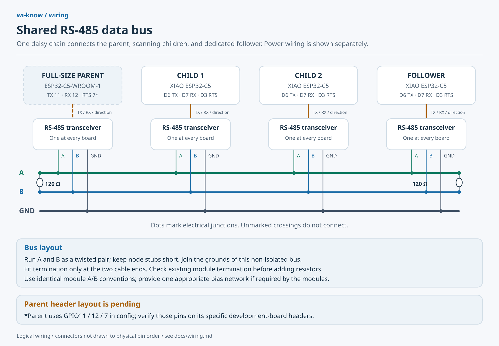

# wi-know

A distributed wireless observation system built around ESP32 microcontrollers.
Children divide the configured 2.4 GHz and 5 GHz Wi-Fi channels; a parent
coordinates them, scans BLE, evaluates detection rules, and records observations.
A dedicated follower spends additional receive time on a selected matching signal.
A [universal image](docs/universal.md) detects the parent from passive harness
identification and assigns worker identities automatically. A parent alone scans
locally and transitions as workers join. An optional manual [standalone parent](config/README.md#standalone-parent) alternates BLE
and Wi-Fi scanning on one board, trading scan coverage for fewer devices.

## Project status

The initial C++ firmware targets ESP-IDF v5.5.1 on ESP32-C5, with parent, child,
and follower roles. It includes passive radio reception, coordination, matching,
GPS/peak tracking, and peripheral drivers. Host tests and firmware builds check the
software; physical hardware validation is still required. Production signatures are not yet included. [Drone Remote ID decoding and storage](docs/remote-id.md)
support BLE, Wi-Fi beacon and passive NAN broadcasts.

## Hardware

| Role / peripheral | Purpose |
| --- | --- |
| ESP32-C5 WiFi6 Dev Board N32R8 parent | Coordination, BLE reception, matching, storage, UI and time |
| Seeed Studio XIAO ESP32-C5 children | Passive Wi-Fi observation across assigned channels |
| Dedicated XIAO ESP32-C5 follower | Focused observation and target reacquisition |
| HiLetgo B07BJ2P6X6 microSD reader (5 V VCC, 3.3 V SPI) | SPI storage; matching observations or all observations, selectable |
| Parent passive buzzer | Configurable match alerts |
| Parent 1602A LCD with 5 V PCF8574 backpack | Two rows of 16 characters; I²C interface |
| Parent Grove GPS (Air530), with onboard backup battery | Receiver coordinates and UTC from NMEA over UART; internal RTC backup |
| Three parent LEDs | Selected signal strength increasing, decreasing, or steady |
| Optional separate battery-backed RTC | Fallback only if Air530 startup time availability proves insufficient |

The C5 supports 2.4/5 GHz Wi-Fi and Bluetooth LE. Bluetooth Classic requires
additional compatible hardware. A node listens to one Wi-Fi channel at a time;
dual-band support does not mean simultaneous observation of both bands. Wi-Fi
and BLE coexistence must be measured on the chosen parent.

GPS coordinates describe the **receiver**, not the detected transmitter. Drone
position, identity, altitude, velocity and direction are available only when
transmitted in a supported, decoded broadcast such as Remote ID. RSSI is not a
distance or bearing measurement. RFID requires a separate suitable reader;
Remote ID and RFID are different technologies. Proprietary drone links and
non-Wi-Fi RF are outside the initial receiver's capabilities.

## Design

See [architecture](docs/architecture.md) for scheduling, protocol, detection,
GPS association, peak RSSI, LED behavior, clock fallback, and implementation stages.
**Edit [config/settings.json](config/settings.json)** for device settings and GPIOs.
**Store matching rules in [rules/](rules/README.md)** as JSON documents.
See [configuration help](config/README.md) and [build/run instructions](docs/firmware.md).
Optional [following-device alerts](config/README.md#following-device-alerts) compare
continued Wi-Fi/BLE sightings with GPS displacement, with an ignore list and
configurable distance and delay.
Settings and rules are validated and compiled into firmware; rebuild after changes.
Parents prefer a configured, writable microSD card and otherwise save logs to
[bounded internal-flash storage](docs/storage.md). Export flash logs over USB with
`python3 tools/export_flash.py --format csv` from an activated ESP-IDF terminal;
the helper handles readback, extraction, and automatic board reset, saving exports
under the Git-ignored `tmp/flash-export-*` directory in this repository. The LCD and serial status show
the selected destination; workers do not write persistent logs.
Export recorded detections to JSON, JSONL, CSV, TSV or GeoJSON with the
[sharing and mapping tool](docs/exporting.md), including rule evidence and receiver
locations at capture and peak signal strength.
An optional [parent peripheral wiring plan](docs/wiring.md#parent-leds-buzzer-screen-and-gps)
includes LED resistors, buzzer transistor, LCD level shifting, GPS and microSD connections,
with a matching example config. Default peripheral pins remain unassigned; use the matching parent example config. Nodes are
assumed to travel together when sharing the parent's GPS.
For one mini XIAO, the [standalone wiring plan](docs/wiring.md#standalone-mini-xiao-esp32-c5)
fits screen, GPS, microSD, buzzer and three LEDs on its 11 header GPIOs, with a
matching configuration and options to omit lower-priority peripherals.

## Wiring



See the [wiring guide](docs/wiring.md) for child/follower pin connections and parallel
power distribution, with editable SVGs and PNG copies. The N32R8 parent has a
separate header map and peripheral wiring plan; its example moves bus RX to GPIO3
to avoid the onboard USB-UART output on GPIO12.

## Quick start

After installing and activating ESP-IDF v5.5.1, connect a board by USB and run:

```sh
python3 tools/flash.py
```

Select the USB port; repeat with the same settings for every board. The helper
builds and flashes the universal image, with no per-board role or ID arguments.
First fit the [parent identification harness](docs/universal.md). See [easy flashing instructions](docs/flashing.md)
for setup, command-line options, dry runs and troubleshooting.

For a manual build without flashing:

With ESP-IDF v5.5.1 activated, run from this directory:

```sh
python3 tools/generate_config.py
idf.py -C firmware -B build-universal -DIDF_TARGET=esp32c5 build
```

Universal firmware selects TX GPIO11 and RTS GPIO7 on both boards, parent RX
GPIO3 or worker RX GPIO12 before starting UART1. Unassigned peripherals remain
disabled. Use `config/settings.universal.example.json` on every board to enable
the parent peripherals; its GPS RX is GPIO26, reserving GPIO10 for identification.
The existing wiring illustrations describe the manual profile; follow the
[universal wiring changes](docs/universal.md) for the new image.
The default ruleset is empty; a disabled test template is in `rules/examples/`.

## Primary references

- [XIAO ESP32-C5 hardware](https://wiki.seeedstudio.com/xiao_esp32c5_getting_started/)
- [ESP32-C5 datasheet](https://www.espressif.com/sites/default/files/documentation/esp32-c5_datasheet_en.pdf)
- [ESP-IDF C5 RF coexistence](https://docs.espressif.com/projects/esp-idf/en/latest/esp32c5/api-guides/coexist.html)
- [Grove Air530 documentation and NMEA serial example](https://wiki.seeedstudio.com/Grove-GPS-Air530/)
- [OpenDroneID Core C](https://github.com/opendroneid/opendroneid-core-c)
- [Eye Spy](https://github.com/simeononsecurity/eye-spy)
- [OUI Spy Unified Blue](https://github.com/colonelpanichacks/oui-spy-unified-blue)

Review source licenses and exact revisions before incorporating signatures or code.
No third-party signatures or code have been imported.
