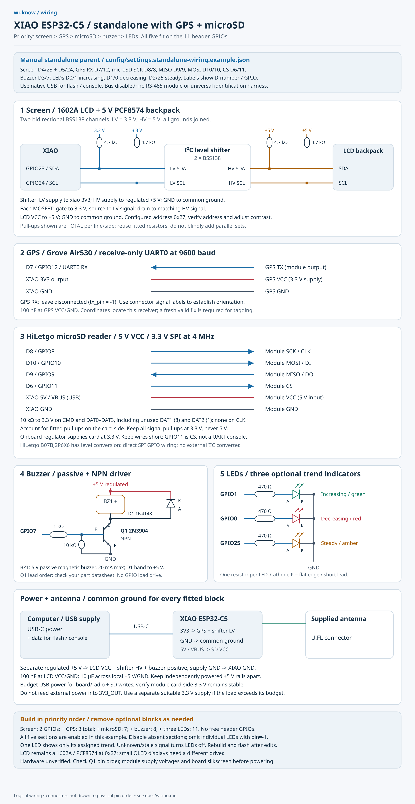

# Wiring diagrams

**The illustrations below show manual profiles.** For a single mini board, use
[standalone XIAO wiring](#standalone-mini-xiao-esp32-c5). Universal images use
[the additional identification harness and GPS RX change](universal.md): GPIO10
is reserved for detection, and parent GPS RX moves from GPIO10 to GPIO26. Do not
connect the legacy GPS wire to GPIO10 when using universal firmware.

For the distributed setup, the parent is the **ESP32-C5 WiFi6 Dev Board N32R8**, with 32 MB flash and 8 MB
PSRAM. The supplied product pinout matches the Waveshare WIFI6-KIT header layout.
The children and dedicated follower are **mini Seeed XIAO ESP32-C5 boards**.
The peripheral drawing shows circuit connections; the separate parent header map
shows positions viewed from the component side, antenna up and USB connectors down.
Compare silkscreen against your board revision before connecting.

The existing firmware targets the C5 chip family used by both boards. Current
`config/settings.json` assigns UART1 TX **GPIO11**, RX **GPIO12**, and RTS **GPIO7**.
Those defaults suit the XIAO workers. **Use the separate parent example config**:
UART1 TX **GPIO11**, RX **GPIO3**, RTS **GPIO7**. Parent GPIO12 is connected to the
USB-UART bridge's TX output; connecting a transceiver RO there would join two
outputs. GPIO11 feeds the bridge RX input, so it remains usable as bus TX. Use the
left **USB** connector for native USB Serial/JTAG console/flashing, not the right
**UART** connector. XIAO D-number labels do not identify parent header positions.

## Standalone mini XIAO ESP32-C5

Use one **Seeed Studio XIAO ESP32-C5** as a manual standalone parent, with
its supplied antenna attached to U.FL. Fit peripherals in this priority order:
**screen, GPS, microSD, buzzer, then LEDs**. All five fit together, including
three trend LEDs, without changing the previous display/buzzer/LED wiring. A bare
board needs only antenna and USB power. This setup has **no RS-485 wiring and no identification
harness**; flash the explicit standalone profile rather than the universal image.



[Editable SVG](images/xiao-standalone-wiring.svg) ·
[Matching example configuration](../config/settings.standalone-wiring.example.json)

The diagram uses the existing supported **1602A LCD with a 5 V PCF8574 backpack**
and the same LED resistors, level shifter and buzzer driver described in
[the circuit details below](#parent-leds-buzzer-screen-and-gps). A small OLED is
not a drop-in replacement: it needs a different firmware display driver. Use the
XIAO assignments here, not the N32R8 parent's GPIO numbers.

| Optional part | XIAO label / GPIO | Connection | GPIO cost |
| --- | --- | --- | --- |
| Display | D4 / GPIO23; D5 / GPIO24 | SDA; SCL through bidirectional BSS138 level shifter to LCD | 2 |
| Grove Air530 GPS | D7 / GPIO12 | GPS TX → UART0 RX; GPS RX left disconnected | 1 |
| HiLetgo SPI microSD reader (5 V VCC) | D8 / GPIO8; D9 / GPIO9; D10 / GPIO10; D6 / GPIO11 | SCK; MISO/DO; MOSI/DI; CS respectively | 4 |
| Buzzer | D3 / GPIO7 | 1 kΩ to 2N3904 base; driver circuit as drawn | 1 |
| Increasing LED (green) | D0 / GPIO1 | 470 Ω → LED anode; cathode → GND | 1 |
| Decreasing LED (red) | D1 / GPIO0 | 470 Ω → LED anode; cathode → GND | 1 |
| Steady LED (amber) | D2 / GPIO25 | 470 Ω → LED anode; cathode → GND | 1 |

Screen + GPS + microSD use **7 GPIOs**; adding the buzzer uses 8; adding all
three LEDs uses **all 11 D0–D10 header GPIOs**. GPS is receive-only, so it needs
no TX pin on the XIAO. The example uses UART0 at 9600 baud and SPI2 at 4 MHz.
USB Serial/JTAG remains available for flashing and console. D6/D7 are repurposed
from the inactive bus, and D10 is microSD MOSI: **do not attach an RS-485 module
or the universal identification harness to this setup**.
Keep `CONFIG_ESP_CONSOLE_USB_SERIAL_JTAG=y` (the repository default); a UART0
console would conflict with GPS and card CS. GPIO11 can carry ROM UART TX during
boot before SPI takes ownership, so leave GPS RX and external UART adapters off
D6. The flash helper below uses an isolated build configuration.
Labels and power pins follow the
[Seeed pin map](https://wiki.seeedstudio.com/xiao_esp32c5_getting_started/).
These are logical connections; compare the board silkscreen for physical pin positions.

Choose the parts before building:

- **All five peripherals:** use the matching example as supplied.
- **Screen + GPS + microSD (recommended compact build):** set `buzzer.enabled`
  and `signal_trend.enabled` to `false`; keep the other three enabled.
- **Screen + GPS:** also set `sd.enabled: false`. For **screen only**, disable
  `gps` as well. Keep the same pin assignments as you add each higher-priority part.
- **One or two LEDs:** keep `signal_trend.enabled: true`, and set each omitted
  LED's `increasing_pin`, `decreasing_pin` or `steady_pin` to `-1`. That GPIO is
  released. Each fitted LED still shows only its named trend; one LED does not
  encode all three states. Unknown or stale signal turns all fitted LEDs off.
- **No LEDs:** set `signal_trend.enabled: false` and leave those branches unwired.
- **No display, GPS, microSD or buzzer:** set that section's `enabled` to `false` and omit
  its entire circuit. The freed pins can be reassigned in a custom configuration.
- **Bare board:** use [the original standalone example](../config/settings.standalone.example.json),
  which disables all peripherals. USB data provides the serial console.

Power the XIAO through USB-C (use a data cable for flashing/console). In the drawn
arrangement, a separate regulated 5 V supply powers the LCD, shifter HV and buzzer;
join its ground to XIAO GND. Connect XIAO **5V/VBUS to the HiLetgo SD module VCC**;
USB supplies this rail. Keep it separate from the external LCD/buzzer 5 V rail.
Use XIAO **3V3_OUT** for GPS VCC and shifter LV, never as an external power input.
Budget USB power for the board, radio and card write-current peaks; verify the
assembled supply under load. If neither display nor buzzer is
fitted, omit the external 5 V load supply. For a USB-free
build, one regulated 5 V source may instead feed XIAO 5V/VBUS and the fitted 5 V
loads with common ground; disconnect that source before attaching powered USB.
Do not join independently powered 5 V rails. Budget the supply for board and loads.

Use a **5 V passive magnetic buzzer rated at no more than 20 mA**, with the shown
2N3904, 1 kΩ base resistor, 10 kΩ base pull-down and 1N4148 flyback diode (band to
+5 V). The LCD's 5 V I²C lines need the shown level shifter and pull-ups; never
connect them directly to the XIAO GPIOs. Buzzer alerts require enabled matching
rules with a buzzer action or enabled following-device alerts; the default ruleset
is empty. LED trends describe signal strength, not direction.

Power the **Grove Air530 at 3.3 V**, join GPS GND to XIAO GND, and connect its TX
to D7; leave GPS RX disconnected (`gps.tx_pin: -1`). Add 100 nF at GPS VCC/GND.
Use connector labels to identify signals, not wire colors. GPS supplies receiver
coordinates and UTC from valid NMEA fixes; it does not locate arbitrary transmitters.

Use the **HiLetgo B07BJ2P6X6 SPI microSD reader**, with module **VCC to XIAO
5V/VBUS** and **GND to XIAO GND**. Its onboard regulator supplies the card at
3.3 V; feeding this module's VCC with 3.3 V can cause initialization timeouts.
Its onboard level conversion accepts XIAO 3.3 V SPI signals: connect the four
SPI wires directly, without an external I²C/IIC level converter. Signal pull-ups
remain at **3.3 V**, never 5 V. Account for card-side resistors already fitted;
CMD and DAT0–DAT3 need separate 10 kΩ pull-ups, including unused DAT1/DAT2.
No pull-up or pull-down is needed on CLK. Keep SPI wires short.
See the [module details and sources below](#parent-leds-buzzer-screen-and-gps).
GPIO25 remains the steady LED; this profile uses SPI2, not SDIO.

Insert a card before boot. Unrecognized/damaged filesystems are automatically
formatted by default, erasing existing data; back up the card first. Set
`sd.format_if_mount_failed: false` to opt out. Mount errors appear on the USB
console and scanning continues. The example keeps
`logging.mode: "matches"`; with the empty default ruleset, ordinary observations
will not populate logs. For a capture check, temporarily set it to `"all"`, then
confirm `/sdcard/WK00000001.LOG` (and subsequent numbered files) contains
JSON-line observations and fresh GPS fixes after acquiring a fix outdoors. See
[log export](exporting.md). Reboot after correcting a mount/write failure; the
driver does not remount automatically. Power down before removing the card;
verify cold boots, sustained writes and GPS reception with every fitted peripheral active.

After activating ESP-IDF, validate and flash from the repository root:

```sh
python3 tools/generate_config.py --config config/settings.standalone-wiring.example.json
python3 tools/flash.py --config config/settings.standalone-wiring.example.json --role parent --node-id 0
```

Settings are compiled in: rebuild and flash after changing your choices. This
profile keeps `standalone.enabled: true`, `bus.enabled: false`, role `parent`
and ID `0`. Wi-Fi and BLE scans alternate on the one radio; see
[standalone behavior](../config/README.md#standalone-parent). The wiring has not
been verified on physical hardware.

## Parent LEDs, buzzer, screen and GPS


[Editable SVG](images/parent-peripherals.svg) ·
[Matching example configuration](../config/settings.parent-wiring.example.json)


[Editable header SVG](images/parent-headers.svg)

P1 is the left header and P2 the right, with pin 1 at the antenna end. Pin names
and onboard connections were checked against the supplied product image and
[Waveshare schematic](https://files.waveshare.com/wiki/ESP32-C5-WIFI6-KIT-NXRX/ESP32-C5-WIFI6-KIT-NXRX-Schematic.pdf).
GPIO6 is battery sensing, GPIO15 is unavailable with this PSRAM variant, GPIO27
drives the onboard RGB LED, and GPIO28 is BOOT. They are excluded from this plan.
GPIO0/1 require the optional 32 kHz crystal to remain unpopulated; GPIO4/5 are
used for LCD rather than external JTAG. Native USB stays on GPIO13/14. See the
[Espressif module datasheet](https://documentation.espressif.com/esp32-c5-wroom-1_wroom-1u_datasheet_en.html).

| Parent connection | Peripheral connection / components |
| --- | --- |
| GPIO0 | 470 Ω resistor → green LED anode; cathode → GND (increasing) |
| GPIO1 | 470 Ω resistor → red LED anode; cathode → GND (decreasing) |
| GPIO8 | 470 Ω resistor → amber LED anode; cathode → GND (steady) |
| GPIO9 / P1.10 | 1 kΩ → Q1 base; 10 kΩ base-to-GND; Q1 emitter → GND |
| Q1 collector | Buzzer negative; buzzer positive → regulated +5 V |
| GPIO4 / GPIO5 | SDA / SCL → level shifter LV side → HV side → LCD SDA / SCL |
| GPIO10, UART0 RX | GPS TX; GPS RX left disconnected |
| GPIO23 / P2.5 | microSD SCK / CLK |
| GPIO24 / P2.4 | microSD MOSI / DI / CMD |
| GPIO2 / P1.3 | microSD MISO / DO / DAT0 |
| GPIO25 / P1.13 | microSD CS / DAT3 |
| Parent 3V3 | GPS VCC and level shifter LV supply |
| External regulated +5 V | LCD VCC, buzzer positive, level shifter HV and HiLetgo SD module VCC |
| Common GND | Parent, external supply, GPS, LCD, microSD, level shifter and Q1 emitter |

For the parent transceiver: P2.2 / GPIO11 → DI, P1.4 / GPIO3 ← RO,
P1.8 / GPIO7 → tied DE and `/RE`. The XIAO workers retain GPIO12 as RX.

Use one 470 Ω resistor per efficient red/green/amber LED (approximately 2–3 mA;
actual current depends on forward voltage). Anode is usually the long lead;
cathode is usually the short lead/flat edge. All LEDs turn off for unknown or stale
signal strength. These indicate changes in strength, not transmitter direction.

The buzzer circuit is designed for a **5 V passive magnetic buzzer drawing no more
than 20 mA**, driven by the configured PWM frequency. Q1 is a 2N3904 NPN; check its
actual package lead order against the
[manufacturer datasheet](https://www.onsemi.com/pdf/datasheet/2n3904-d.pdf).
The 1 kΩ resistor limits base current; the 10 kΩ resistor holds Q1 off during reset.
D1 is a 1N4148 across the buzzer: **banded cathode to +5 V, anode to the collector**.
It suppresses the magnetic load's turn-off transient. Select a different driver
for a higher-current buzzer; an active buzzer or bare piezo is a different load
and should not be substituted without checking its drive requirements.

The LCD circuit uses a **1602A LCD with a 5 V PCF8574 backpack**, configured at
`0x27` with the driver's documented pin mapping. Use a two-channel **bidirectional I²C level
shifter**, with each BSS138 gate at 3.3 V, source on the LV bus, and drain on the
HV bus. Each SDA/SCL line needs a pull-up on each side: 4.7 kΩ to 3.3 V on LV and
4.7 kΩ to 5 V on HV. The drawing shows the intended total pull-ups; check resistors
already on the backpack/shifter before adding more. This follows
[Nexperia's I²C level shifting circuit](https://assets.nexperia.com/documents/application-note/AN10441.pdf).
Do not connect the 5 V bus directly to ESP32 GPIOs. Adjust the backpack contrast
trimmer and verify its address and mapping; a bare parallel LCD needs different wiring.

Power the Grove Air530 from 3.3 V and connect its **TX to parent RX**, using the
connector signal labels to establish orientation. Seeed lists a 3.3 V/5 V supply
and up to 60 mA working current for the
[Grove Air530](https://wiki.seeedstudio.com/Grove-GPS-Air530/); allow sufficient
headroom on the parent's 3V3 regulator. No parent TX connection is needed for NMEA
reception. Coordinates identify the receiver's location.

The diagrams use the **[HiLetgo B07BJ2P6X6 reader](https://www.amazon.com/dp/B07BJ2P6X6)**
(manufacturer part 3-01-0038). [HiLetgo specifies](https://hiletgo.com/5pcs-Micro-SD-Carte-TF-Adater-Reader-Module-PG2158021)
a **4.5–5.5 V VCC input**, an onboard 3.3 V regulator, and level conversion for
3.3 V or 5 V host interfaces. Connect the parent's external regulated **+5 V to
module VCC**, and module GND to common ground. Connect SPI signals directly to
the listed GPIOs; no external I²C/IIC converter is needed. The LCD still needs
its separate I²C level shifter.

**Module VCC is not bare-card VDD.** Never apply 5 V to card contacts or ESP32
GPIOs. A native 3.3 V breakout without this regulator must instead use 3.3 V;
verify the actual board before substituting another module. The earlier HW-125
identification was unconfirmed.

On the card side, contact numbers are CLK=5, CMD=3, DAT0=7, DAT3/CS=2, VDD=4
and VSS=6; these are not the module's header order. Account for fitted resistors:
CMD and DAT0–DAT3 each need a 10 kΩ pull-up to **3.3 V**, including unused DAT1
(contact 8) and DAT2 (contact 1). No pull-up/down goes on CLK. See
[Espressif's SD pull-up requirements](https://docs.espressif.com/projects/esp-idf/en/v5.5.1/esp32c5/api-reference/peripherals/sd_pullup_requirements.html).
GPIO25's pull-up affects an SDIO clock-edge strap; this firmware uses normal SPI
boot and SPI2, not SDIO. GPIO2/3 also serve pad JTAG/SDIO strap functions; this
plan uses native USB JTAG. Keep wires short; the example uses a 4 MHz SPI clock.

Fit 100 nF decoupling across VCC/GND near each GPS/LCD module, plus 10 µF across
the local 5 V load rail; fit 100 nF plus 10 µF near microSD VDD/VSS as well (observe
polarity for polarized capacitors). Power the parent through its native USB port;
supply LCD/buzzer/SD module VCC from a regulated 5 V rail with common ground. Leave P1.14 / 5V
unconnected in this arrangement; do not join independently powered 5 V rails or
backfeed USB. VBAT is the battery rail, not a 5 V peripheral supply.

The example enables GPS, LCD, buzzer, LEDs and microSD with these assignments and
changes parent bus RX to GPIO3. Default `settings.json` is unchanged. Build
from the repository root with this example, or copy its peripheral settings into
your chosen config:

```sh
python3 tools/generate_config.py --config config/settings.parent-wiring.example.json
idf.py -C firmware -B build-parent-wiring -DIDF_TARGET=esp32c5 -DWIKNOW_ROLE=parent -DWIKNOW_NODE_ID=0 -DWIKNOW_CONFIG="$PWD/config/settings.parent-wiring.example.json" build
```

N32R8 identifies memory capacity; this example retains the existing conservative
firmware flash/partition settings and does not enable PSRAM. The application does
not need all 32 MB flash or PSRAM to operate.

The buzzer sounds only for a matching enabled rule with its `buzzer` action set;
the default ruleset is empty. Hardware operation is still unverified.

## Each mini child and follower


[Editable SVG](images/xiao-rs485-wiring.svg)

| XIAO label | GPIO / function | Local 3.3 V RS-485 module |
| --- | --- | --- |
| D6 | GPIO11 / TX | DI (sometimes D) |
| D7 | GPIO12 / RX | RO (sometimes R) |
| D3 | GPIO7 / direction | DE and active-low `/RE`, tied together |
| 3V3 | Regulated output | VCC for a module designed for 3.3 V |
| GND | Ground | GND |

Use a manually controlled, half-duplex transceiver with **3.3 V supply and logic
compatibility**. A module that drives RO at 5 V is unsuitable for direct ESP32 input.
This wiring corresponds to circuit B in
[Espressif's RS-485 interface documentation](https://docs.espressif.com/projects/esp-idf/en/v5.5.1/esp32c5/api-reference/peripherals/uart.html#interface-connection-options).
The D-to-GPIO mapping comes from the
[Seeed XIAO ESP32-C5 pin map](https://wiki.seeedstudio.com/xiao_esp32c5_getting_started/).

## Parent and all nodes on one data bus


[Editable SVG](images/rs485-network.svg)

Provide one transceiver per board, including the parent. Connect A to A, B to B,
and grounds together for this non-isolated bus. Use a twisted pair for A/B in a
linear daisy chain with short stubs. Connection dots indicate junctions; crossings
without dots are not connected. Physical cable order does not determine software
roles or node IDs.

Fit 120 Ω termination across A/B at each physical cable end, accounting for any
termination already on the modules. Middle nodes should not add termination.
Check module documentation for bias resistors/failsafe behavior and A/B naming;
use one appropriate bias network if required. See the
[TI RS-485 transceiver datasheet](https://www.ti.com/lit/ds/symlink/thvd1450.pdf)
for bus topology and termination guidance.

Do not tie bare ESP32 TX pins together. Universal images assign worker roles and
IDs at runtime. Explicit manual builds use parent ID 0 and unique nonzero worker
IDs on a separate bus; see [firmware instructions](firmware.md).

## Power distribution


[Editable SVG](images/power-distribution.svg)

For the mini XIAOs, distribute **regulated 5 V to VBUS** and ground to GND, in
parallel, or power each board via USB. Their `3V3` header pin is documented as
`3V3_OUT`; use it to supply that board's own 3.3 V transceiver. Do not connect
different boards' 3V3 outputs together or feed external power into those outputs.
See the [Seeed power/pin documentation](https://wiki.seeedstudio.com/xiao_esp32c5_getting_started/).

For the N32R8 parent, use its native USB power input. The diagram deliberately
leaves its 5V header unconnected while an external 5 V rail supplies the LCD/buzzer/SD module.
The ESP32-C5-WROOM-1 module itself is a 3.3 V device; a module supply pin must
not be mistaken for a development board's regulated 5 V input. See the
[Espressif module datasheet](https://documentation.espressif.com/esp32-c5-wroom-1_wroom-1u_datasheet_en.html).

Budget supply current for all boards, their transceivers and the parent's peripherals.
The LCD backpack and identified HiLetgo SD module VCC use 5 V. Parent GPS, LCD, buzzer and LED connections are shown above;
the separate header map includes microSD. The SD diagrams now use the identified HiLetgo reader with 5 V module VCC.

## Image sources

These diagrams are generated deterministically from editable Python/SVG sources,
so labels and wire endpoints do not depend on image-model rendering. PNG copies
are provided for repository previews. Regenerate SVGs with standard Python:

```sh
python3 tools/generate_wiring.py
```

To also regenerate PNGs, install `resvg-py` in your chosen Python environment and run:

```sh
python3 tools/generate_wiring.py --png
```

The renderer needs an installed sans-serif font. On systems without fonts, pass
`--font /path/to/font.ttf` (repeatable); the included PNGs were rendered with Noto Sans.
No image-generation API or secret is needed. Update the diagrams when changing
pin assignments. These diagrams document the intended wiring; hardware operation
has not yet been verified on the physical boards.
