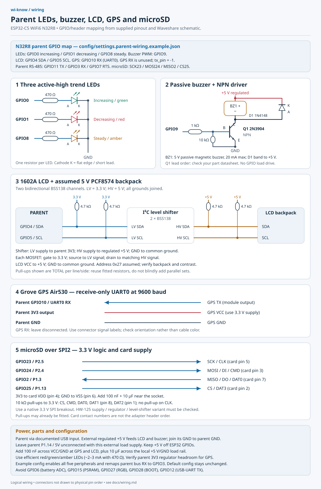
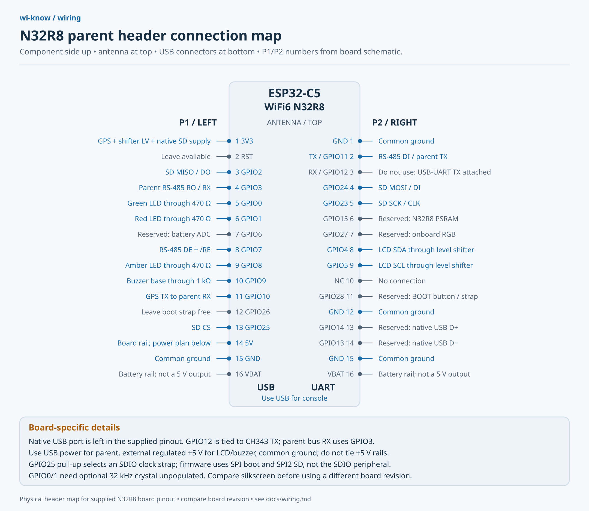
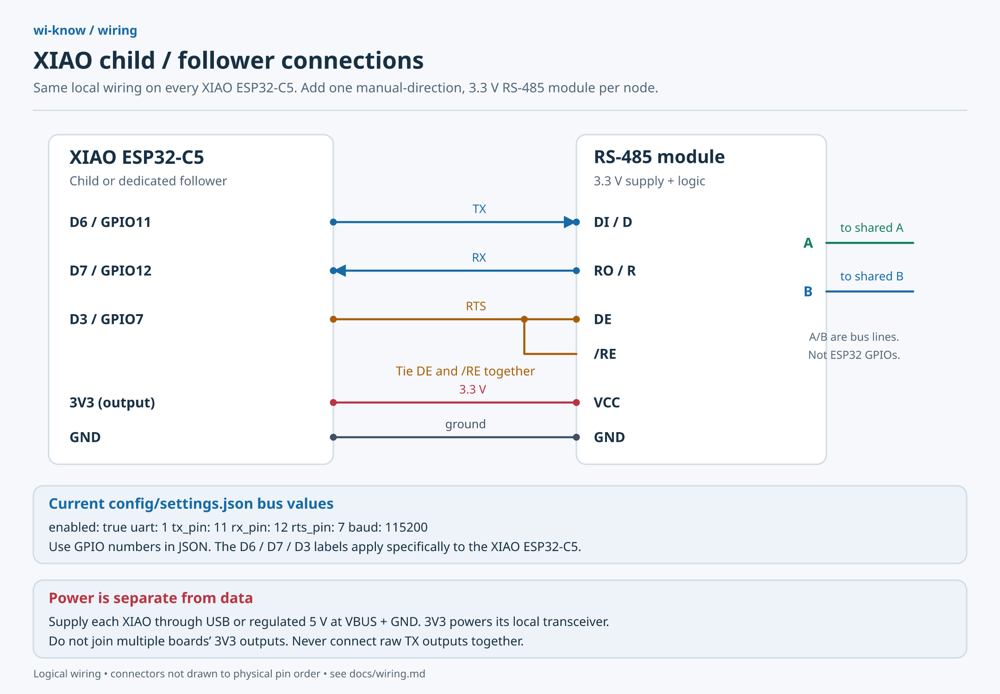
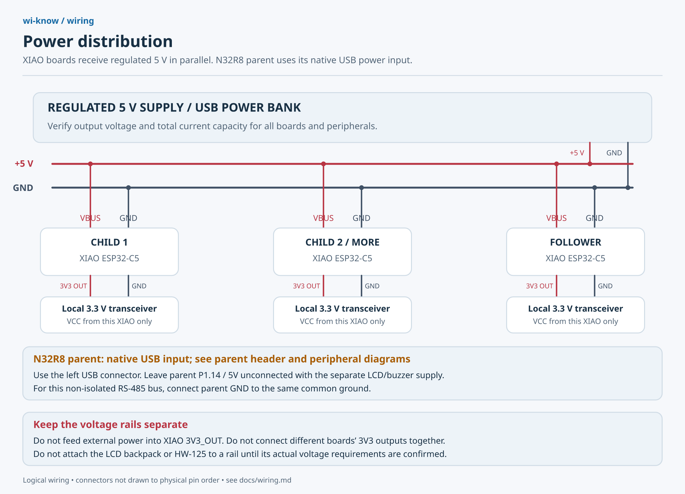

# Wiring diagrams

The parent is the **ESP32-C5 WiFi6 Dev Board N32R8**, with 32 MB flash and 8 MB
PSRAM. The supplied product pinout matches the Waveshare WIFI6-KIT header layout.
The children and dedicated follower are **mini Seeed XIAO ESP32-C5 boards**.
The peripheral drawing shows circuit connections; the separate parent header map
shows positions viewed from the component side, antenna up and USB connectors down.
Compare silkscreen against your board revision before connecting.

The existing firmware targets the C5 chip family used by both boards. Current
`config/settings.json` assigns UART1 TX **GPIO11**, RX **GPIO12**, and RTS **GPIO7**.
Those defaults suit the XIAO workers. **Use the separate parent example config**:
UART1 TX **GPIO11**, RX **GPIO3**, RTS **GPIO7**. Parent GPIO12 is connected to the
USB-UART bridge's TX output; connecting a transceiver RO there would join two
outputs. GPIO11 feeds the bridge RX input, so it remains usable as bus TX. Use the
left **USB** connector for native USB Serial/JTAG console/flashing, not the right
**UART** connector. XIAO D-number labels do not identify parent header positions.

## Parent LEDs, buzzer, screen and GPS



[Editable SVG](images/parent-peripherals.svg) ·
[Matching example configuration](../config/settings.parent-wiring.example.json)



[Editable header SVG](images/parent-headers.svg)

P1 is the left header and P2 the right, with pin 1 at the antenna end. Pin names
and onboard connections were checked against the supplied product image and
[Waveshare schematic](https://files.waveshare.com/wiki/ESP32-C5-WIFI6-KIT-NXRX/ESP32-C5-WIFI6-KIT-NXRX-Schematic.pdf).
GPIO6 is battery sensing, GPIO15 is unavailable with this PSRAM variant, GPIO27
drives the onboard RGB LED, and GPIO28 is BOOT. They are excluded from this plan.
GPIO0/1 require the optional 32 kHz crystal to remain unpopulated; GPIO4/5 are
used for LCD rather than external JTAG. Native USB stays on GPIO13/14. See the
[Espressif module datasheet](https://documentation.espressif.com/esp32-c5-wroom-1_wroom-1u_datasheet_en.html).

| Parent connection | Peripheral connection / components |
| --- | --- |
| GPIO0 | 470 Ω resistor → green LED anode; cathode → GND (increasing) |
| GPIO1 | 470 Ω resistor → red LED anode; cathode → GND (decreasing) |
| GPIO8 | 470 Ω resistor → amber LED anode; cathode → GND (steady) |
| GPIO9 / P1.10 | 1 kΩ → Q1 base; 10 kΩ base-to-GND; Q1 emitter → GND |
| Q1 collector | Buzzer negative; buzzer positive → regulated +5 V |
| GPIO4 / GPIO5 | SDA / SCL → level shifter LV side → HV side → LCD SDA / SCL |
| GPIO10, UART0 RX | GPS TX; GPS RX left disconnected |
| GPIO23 / P2.5 | microSD SCK / CLK |
| GPIO24 / P2.4 | microSD MOSI / DI / CMD |
| GPIO2 / P1.3 | microSD MISO / DO / DAT0 |
| GPIO25 / P1.13 | microSD CS / DAT3 |
| Parent 3V3 | GPS VCC, level shifter LV supply, native 3.3 V microSD breakout |
| External regulated +5 V | LCD VCC, buzzer positive and level shifter HV supply |
| Common GND | Parent, external supply, GPS, LCD, microSD, level shifter and Q1 emitter |

For the parent transceiver: P2.2 / GPIO11 → DI, P1.4 / GPIO3 ← RO,
P1.8 / GPIO7 → tied DE and `/RE`. The XIAO workers retain GPIO12 as RX.

Use one 470 Ω resistor per efficient red/green/amber LED (approximately 2–3 mA;
actual current depends on forward voltage). Anode is usually the long lead;
cathode is usually the short lead/flat edge. All LEDs turn off for unknown or stale
signal strength. These indicate changes in strength, not transmitter direction.

The buzzer circuit is designed for a **5 V passive magnetic buzzer drawing no more
than 20 mA**, driven by the configured PWM frequency. Q1 is a 2N3904 NPN; check its
actual package lead order against the
[manufacturer datasheet](https://www.onsemi.com/pdf/datasheet/2n3904-d.pdf).
The 1 kΩ resistor limits base current; the 10 kΩ resistor holds Q1 off during reset.
D1 is a 1N4148 across the buzzer: **banded cathode to +5 V, anode to the collector**.
It suppresses the magnetic load's turn-off transient. Select a different driver
for a higher-current buzzer; an active buzzer or bare piezo is a different load
and should not be substituted without checking its drive requirements.

The LCD circuit assumes a **5 V 1602A with PCF8574 backpack**, at `0x27` with the
driver's documented pin mapping. Use a two-channel **bidirectional I²C level
shifter**, with each BSS138 gate at 3.3 V, source on the LV bus, and drain on the
HV bus. Each SDA/SCL line needs a pull-up on each side: 4.7 kΩ to 3.3 V on LV and
4.7 kΩ to 5 V on HV. The drawing shows the intended total pull-ups; check resistors
already on the backpack/shifter before adding more. This follows
[Nexperia's I²C level shifting circuit](https://assets.nexperia.com/documents/application-note/AN10441.pdf).
Do not connect the 5 V bus directly to ESP32 GPIOs. Adjust the backpack contrast
trimmer and verify its address and mapping; a bare parallel LCD needs different wiring.

Power the Grove Air530 from 3.3 V and connect its **TX to parent RX**, using the
connector signal labels to establish orientation. Seeed lists a 3.3 V/5 V supply
and up to 60 mA working current for the
[Grove Air530](https://wiki.seeedstudio.com/Grove-GPS-Air530/); allow sufficient
headroom on the parent's 3V3 regulator. No parent TX connection is needed for NMEA
reception. Coordinates identify the receiver's location.

Use a **native 3.3 V SPI microSD breakout** for the shown card circuit. VDD goes
to 3V3, VSS to common ground. Card contact numbers are CLK=5, CMD=3, DAT0=7,
DAT3/CS=2, VDD=4 and VSS=6; these are not the adapter header order. Fit 10 kΩ
pull-ups to 3.3 V on CMD and DAT0–DAT3, including unused DAT1 (contact 8) and DAT2
(contact 1), accounting for resistors already on the breakout. No pull-up goes on
CLK. See [Espressif's SD pull-up requirements](https://docs.espressif.com/projects/esp-idf/en/v5.5.1/esp32c5/api-reference/peripherals/sd_pullup_requirements.html).
GPIO25's pull-up affects an SDIO clock-edge strap; this firmware uses normal SPI
boot and SPI2 for the card, with no SDIO slave interface. GPIO2/3 also serve pad
JTAG/SDIO strap functions; this plan uses native USB JTAG and no SDIO interface.
Keep wires short; the example uses a conservative 4 MHz SPI clock.

The previously proposed **HW-125 is still unconfirmed**. Some adapter variants
have an onboard regulator or different logic circuitry. Verify the actual module
before choosing its input supply: feeding 3.3 V through a regulator intended for
5 V can undervolt the card. Any module used must present 3.3 V SPI logic to the
ESP32. The drawing does not assume a particular HW-125 supply pin.

Fit 100 nF decoupling across VCC/GND near each GPS/LCD module, plus 10 µF across
the local 5 V load rail; fit 100 nF plus 10 µF near microSD VDD/VSS as well (observe
polarity for polarized capacitors). Power the parent through its native USB port;
supply LCD/buzzer from a regulated 5 V rail with common ground. Leave P1.14 / 5V
unconnected in this arrangement; do not join independently powered 5 V rails or
backfeed USB. VBAT is the battery rail, not a 5 V peripheral supply.

The example enables GPS, LCD, buzzer, LEDs and microSD with these assignments and
changes parent bus RX to GPIO3. Default `settings.json` is unchanged. Build
from the repository root with this example, or copy its peripheral settings into
your chosen config:

```sh
python3 tools/generate_config.py --config config/settings.parent-wiring.example.json
idf.py -C firmware -B build-parent-wiring -DIDF_TARGET=esp32c5 -DWIKNOW_ROLE=parent -DWIKNOW_NODE_ID=0 -DWIKNOW_CONFIG="$PWD/config/settings.parent-wiring.example.json" build
```

N32R8 identifies memory capacity; this example retains the existing conservative
firmware flash/partition settings and does not enable PSRAM. The application does
not need all 32 MB flash or PSRAM to operate.

The buzzer sounds only for a matching enabled rule with its `buzzer` action set;
the default ruleset is empty. Hardware operation is still unverified.

## Each mini child and follower



[Editable SVG](images/xiao-rs485-wiring.svg)

| XIAO label | GPIO / function | Local 3.3 V RS-485 module |
| --- | --- | --- |
| D6 | GPIO11 / TX | DI (sometimes D) |
| D7 | GPIO12 / RX | RO (sometimes R) |
| D3 | GPIO7 / direction | DE and active-low `/RE`, tied together |
| 3V3 | Regulated output | VCC for a module designed for 3.3 V |
| GND | Ground | GND |

Use a manually controlled, half-duplex transceiver with **3.3 V supply and logic
compatibility**. A module that drives RO at 5 V is unsuitable for direct ESP32 input.
This wiring corresponds to circuit B in
[Espressif's RS-485 interface documentation](https://docs.espressif.com/projects/esp-idf/en/v5.5.1/esp32c5/api-reference/peripherals/uart.html#interface-connection-options).
The D-to-GPIO mapping comes from the
[Seeed XIAO ESP32-C5 pin map](https://wiki.seeedstudio.com/xiao_esp32c5_getting_started/).

## Parent and all nodes on one data bus


[Editable SVG](images/rs485-network.svg)

Provide one transceiver per board, including the parent. Connect A to A, B to B,
and grounds together for this non-isolated bus. Use a twisted pair for A/B in a
linear daisy chain with short stubs. Connection dots indicate junctions; crossings
without dots are not connected. Physical cable order does not determine software
roles or node IDs.

Fit 120 Ω termination across A/B at each physical cable end, accounting for any
termination already on the modules. Middle nodes should not add termination.
Check module documentation for bias resistors/failsafe behavior and A/B naming;
use one appropriate bias network if required. See the
[TI RS-485 transceiver datasheet](https://www.ti.com/lit/ds/symlink/thvd1450.pdf)
for bus topology and termination guidance.

Do not tie bare ESP32 TX pins together. Give the parent ID 0 and each child/follower
a unique nonzero ID within the parent's configured discovery range. Node roles
and IDs are set when building; see [firmware instructions](firmware.md).

## Power distribution



[Editable SVG](images/power-distribution.svg)

For the mini XIAOs, distribute **regulated 5 V to VBUS** and ground to GND, in
parallel, or power each board via USB. Their `3V3` header pin is documented as
`3V3_OUT`; use it to supply that board's own 3.3 V transceiver. Do not connect
different boards' 3V3 outputs together or feed external power into those outputs.
See the [Seeed power/pin documentation](https://wiki.seeedstudio.com/xiao_esp32c5_getting_started/).

For the N32R8 parent, use its native USB power input. The diagram deliberately
leaves its 5V header unconnected while an external 5 V rail supplies the LCD/buzzer.
The ESP32-C5-WROOM-1 module itself is a 3.3 V device; a module supply pin must
not be mistaken for a development board's regulated 5 V input. See the
[Espressif module datasheet](https://documentation.espressif.com/esp32-c5-wroom-1_wroom-1u_datasheet_en.html).

Budget supply current for all boards, their transceivers and the parent's peripherals.
Do not assume the LCD backpack or probable HW-125 accepts a particular supply voltage
until identified. Parent GPS, LCD, buzzer and LED connections are shown above;
the separate header map includes microSD. The HW-125 variant still needs identification.

## Image sources

These diagrams are generated deterministically from editable Python/SVG sources,
so labels and wire endpoints do not depend on image-model rendering. PNG copies
are provided for repository previews. Regenerate SVGs with standard Python:

```sh
python3 tools/generate_wiring.py
```

To also regenerate PNGs, install `resvg-py` in your chosen Python environment and run:

```sh
python3 tools/generate_wiring.py --png
```

The renderer needs an installed sans-serif font. On systems without fonts, pass
`--font /path/to/font.ttf` (repeatable); the included PNGs were rendered with Noto Sans.
No image-generation API or secret is needed. Update the diagrams when changing
pin assignments. These diagrams document the intended wiring; hardware operation
has not yet been verified on the physical boards.
